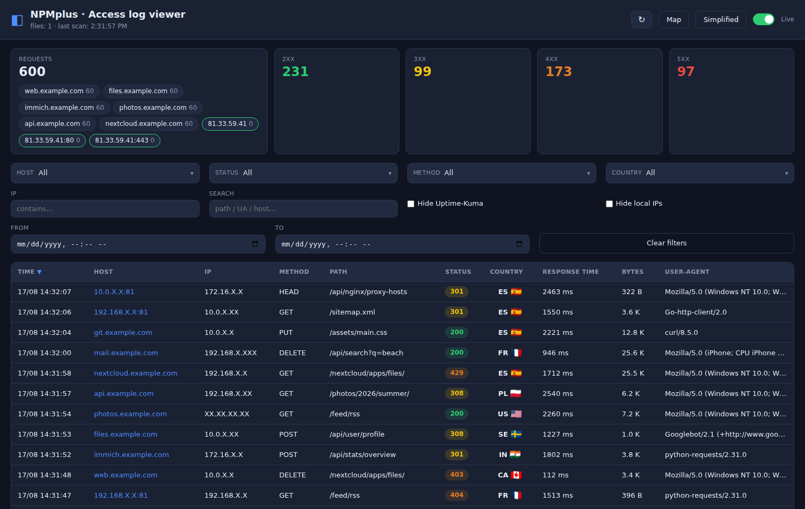
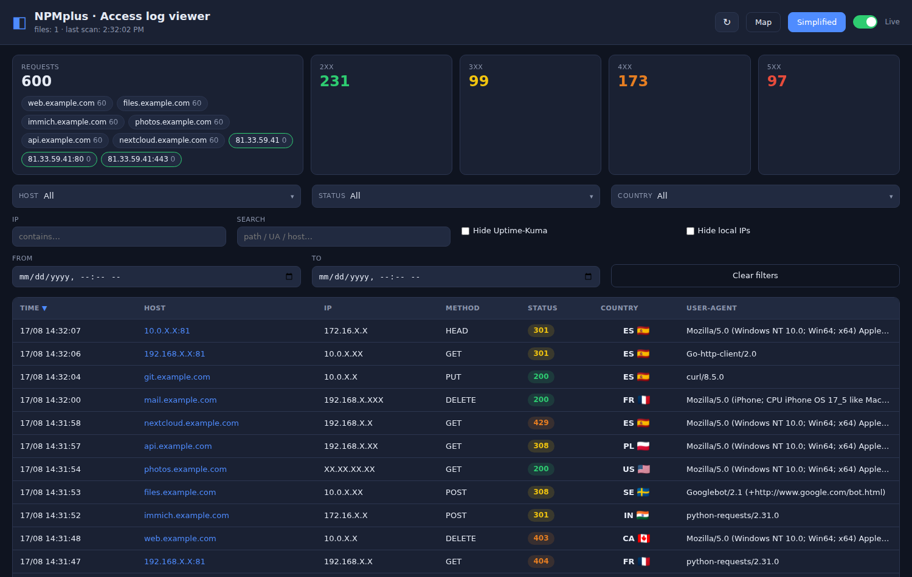
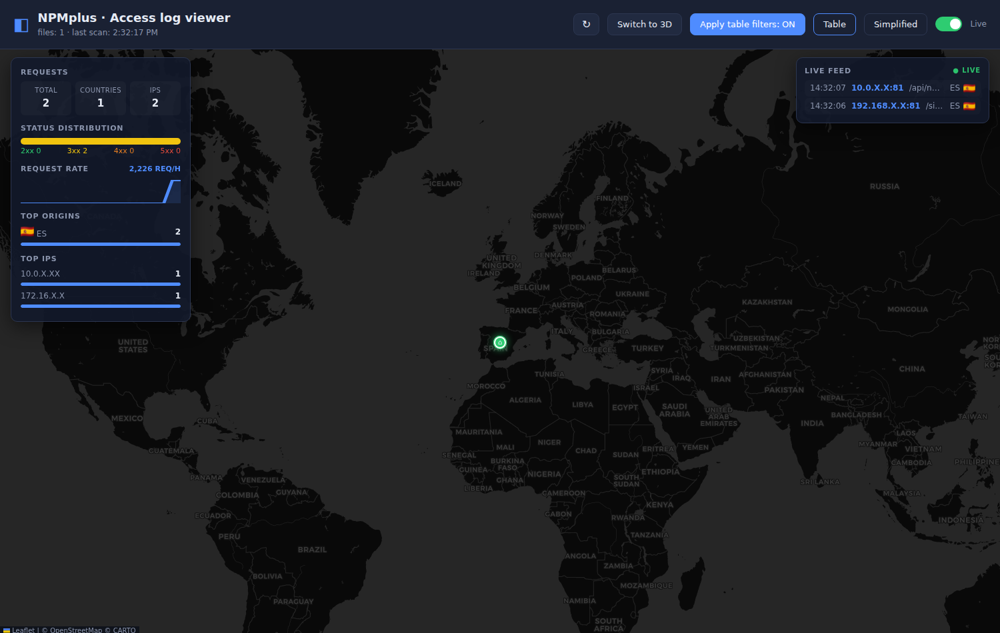
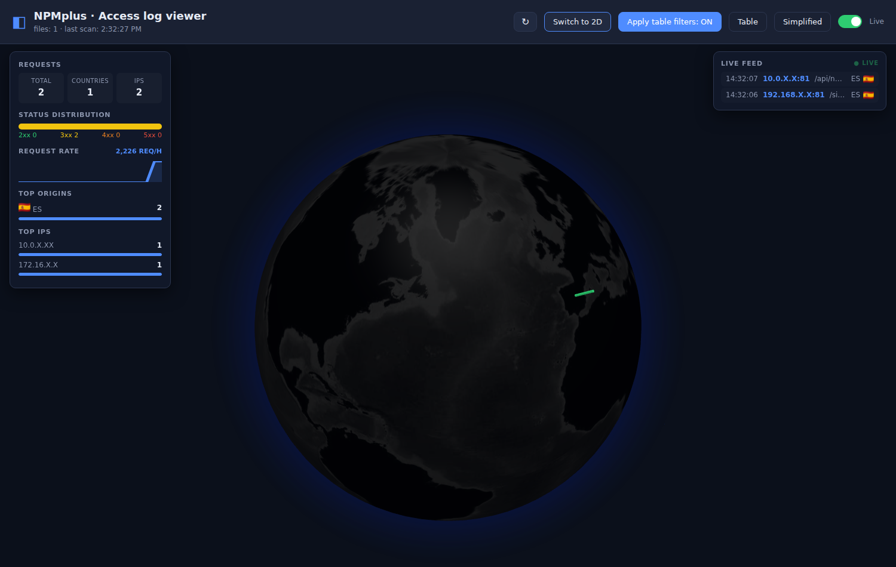

# NPMplus · Access log viewer

[](https://github.com/LoR3daN/npmplus-logviewer/actions/workflows/docker-image.yml)
[](https://ghcr.io/lor3dan/npmplus-logviewer)
[](https://github.com/LoR3daN/npmplus-logviewer)

A FastAPI web app that reads the NPMplus access log and shows a filterable
table, request summary and a live animated map.

The viewer reads **`access_detailed.log`**, a single-line log written by
NPMplus. Each request contains host, IP, method, path, status, response time,
bytes, user-agent and country. It does **not** read NPMplus's normal
`access.log`, so CrowdSec and GoAccess can keep using it.

---

## Screenshots

| Table view | Simplified view |
|---|---|
|  |  |

| 2D map | 3D globe |
|---|---|
|  |  |

> Screenshots use sample, sanitized data (masked IPs and placeholder hostnames).

---

## What you need

- Docker and Docker Compose.
- NPMplus running with **`NGINX_LOAD_GEOIP2_MODULE=true`** and a GeoIP2
  database.
- The NPMplus logs available on the host at `/opt/npmplus/nginx/logs`.
- The `access_detailed.log` format added to NPMplus (see below).

The format below uses `$geoip2_country_iso_code`. If your NPMplus does not have
the GeoIP2 module/database, replace that variable with `-` in the format. The
viewer will still work, but the country column and map beams will be empty.

## Quick start

1. Enable `NGINX_LOAD_GEOIP2_MODULE=true` and make the GeoIP2 database available.
2. Add the `geoip_detailed` format to NPMplus `custom_nginx/http.conf`.
3. Run `nginx -t` and `nginx -s reload` inside the NPMplus container.
4. Deploy the viewer with `/opt/npmplus/nginx/logs:/logs:ro`.
5. Open <http://localhost:8899> and protect it with an Access List.

---

## NPMplus setup

### 1. Enable the GeoIP2 module

In your NPMplus compose file:

```yaml
services:
  npmplus:
    environment:
      - "TZ=Europe/Madrid"
      - "LOGROTATE=true"
      - "LOGROTATIONS=30"
      - "NGINX_LOAD_GEOIP2_MODULE=true"
      # Optional: disable GoAccess. Keep LOGROTATE=true for rotation/CrowdSec.
      - "GOA=false"
    volumes:
      - "/opt/npmplus:/data"
      - "/opt/npmplus/goaccess/geoip:/etc/nginx/geoip"
```

- `LOGROTATE=true` keeps NPMplus writing and rotating `access.log`,
  `access_detailed.log`, `error.log` and `stream.log`.
- `LOGROTATIONS` is how many daily rotations are kept. Use 7, 14 or 30
  depending on your disk.
- `NGINX_LOAD_GEOIP2_MODULE=true` is required for the country code.
- `GOA` is optional. If you use GoAccess, leave it at `true`; if you do not,
  `GOA=false` is fine, but keep `LOGROTATE=true`.

The GeoIP database is read from `/opt/npmplus/goaccess/geoip` and mounted into
NPMplus as `/etc/nginx/geoip`. You can fill it with the `geoipupdate` container
or by placing the MaxMind files there manually.

### 2. Add the detailed log format

Edit `/opt/npmplus/custom_nginx/http.conf` on the host and add:

```nginx
log_format geoip_detailed '[$time_local] $host$is_request_port$request_port $remote_addr $request_time "$request" $status $body_bytes_sent $bytes_sent "$http_referer" "$http_user_agent" [$geoip2_country_iso_code]';

access_log /data/nginx/logs/access_detailed.log geoip_detailed;
```

Do not remove `access.log`: CrowdSec, GoAccess or other tools may still use it.
The viewer only reads `access_detailed.log`.

Validate and reload Nginx:

```bash
docker exec npmplus nginx -t
docker exec npmplus nginx -s reload
```

Check that the file is being written:

```bash
tail -n 2 /opt/npmplus/nginx/logs/access_detailed.log
```

It should look like this:

```text
[14/Aug/2026:21:54:55 +0200] cloud.example.com 203.0.113.10 0.000 "GET / HTTP/2.0" 302 116 366 "-" "Mozilla/5.0 (...)" [ES]
```

If you see old two-line entries in the file, ignore them: the viewer skips
them and they disappear when the file rotates.

---

## Deploy the viewer

Add this service to the same Compose file as NPMplus, or run it standalone:

```yaml
services:
  logviewer:
    container_name: logviewer
    image: ghcr.io/lor3dan/npmplus-logviewer:latest
    restart: unless-stopped
    network_mode: host
    environment:
      - "TZ=Europe/Madrid"
      # Optional: hosts shown as chips. Empty = top 6.
      # - "CARDS_HOSTS=cloud.example.com,jellyfin.example.com"
      # Optional: force the server public IP.
      # - "MY_IP=203.0.113.10"
      # Optional: CARTO basemaps API key for the 2D map.
      # - "CARTO_KEY=your_key"
    volumes:
      - "/opt/npmplus/nginx/logs:/logs:ro"
      - "logviewer-state:/state"

volumes:
  logviewer-state:
```

```bash
docker compose up -d
```

Open <http://localhost:8899>.

The mount is read-only. The viewer does not need write access to the logs and
does not modify NPMplus.

### Expose it through NPMplus

The app has **no built-in login**. If you expose it through a domain, add an
NPMplus **Access List** or Basic Auth to the proxy host:

- Domain: `logs.yourdomain.com`
- Forward hostname/IP: `127.0.0.1`
- Forward port: `8899`

### Upgrade

```bash
docker compose pull && docker compose up -d
```

---

## How the log rotation works

NPMplus rotates every `*.log` file in `/data/nginx/logs` daily using
`copytruncate`:

- The active `access_detailed.log` is copied to `.1` and then truncated.
- Older files become `.2`, `.3`, ...
- Files beyond `LOGROTATIONS` are deleted.
- No compression is applied by NPMplus. The viewer ignores `.gz` rotations if
  you enable compression yourself.
- `access_detailed.log` roughly doubles log disk usage because `access.log` is
  still written for CrowdSec/GoAccess.

The viewer reads `access_detailed.log`, `.1`, `.2`... and handles truncation
and incomplete lines. You do not need a separate logrotate configuration.

Do **not** disable log rotation to "simplify" things. If you set
`LOGROTATE=false`, NPMplus stops writing `access.log` and CrowdSec/GoAccess lose
their data; `access_detailed.log` may still grow without rotation. If you only
stop the rotation process, the files grow until the disk is full.

---

## Environment variables

| Variable | Default | Description |
|---|---|---|
| `LOG_DIR` | `/logs` | Folder containing `access_detailed.log*` |
| `REFRESH_SECONDS` | `5` | Log rescan interval |
| `TZ` | `Europe/Madrid` | Timezone used by the date filters |
| `PREF_FILE` | `/state/prefs.json` | Saved filters |
| `CARDS_HOSTS` | *(empty)* | Hosts shown as chips, comma separated |
| `MY_IP` | *(empty)* | Override the server public IP |
| `PUBLIC_IP_REFRESH` | `600` | Seconds between public-IP checks |
| `CARTO_KEY` | *(empty)* | Optional CARTO basemaps API key |

If `MY_IP` is empty, the app asks an external what-is-my-IP API and refreshes the
result every `PUBLIC_IP_REFRESH` seconds. If the API is unreachable, it falls back
to the logs, the request `Host` header or forwarded client IPs.

If you use Cloudflare, set `TRUST_CLOUDFLARE=true` in NPMplus so `$remote_addr`
is the real client IP and not a Cloudflare address.

---

## Features

- **Request table** with time, host, IP, method, path, status, country, response
  time, bytes and user-agent. Sort any column and choose 25/50/100/200 rows per
  page.
- **Filters** for host, status, method and country (multi-select), IP, free-text
  search, date range, hide Uptime-Kuma and hide local IPs. Filters are saved on
  the server and restored after a restart.
- **Simplified view** collapses consecutive requests from the same IP and host
  into one row with a `×N` badge.
- **Summary cards** with total requests, 2xx/3xx/4xx/5xx breakdown and host
  chips. The server public IP is shown as `IP`, `IP:80` and `IP:443` chips.
- **Live map** with Leaflet 2D and globe.gl 3D: animated beams from each country
  to the server, a live feed and mini statistics.
- **Live mode** refreshes every 5 seconds and has a manual rescan button.
- **Robust reading**: handles log rotation, truncation and lines that are being
  written.

---

## Troubleshooting

### The viewer shows no data

Check that NPMplus is writing the file:

```bash
tail -f /opt/npmplus/nginx/logs/access_detailed.log
```

Check that the viewer sees the same directory:

```bash
docker exec logviewer ls -la /logs
```

Check the mount in the viewer Compose file:

```yaml
volumes:
  - "/opt/npmplus/nginx/logs:/logs:ro"
```

If the file exists but the viewer does not see it, the host path or the mount is
wrong.

### Nginx fails after editing `http.conf`

Run:

```bash
nl -ba /opt/npmplus/custom_nginx/http.conf
docker exec npmplus nginx -t
```

Look for a stray word, a missing semicolon or a duplicated `access_log` line.
The file must contain the two lines from the setup section, with
`log_format` before `access_log`.

### The country column is empty

Check the GeoIP2 module and database:

```bash
docker exec npmplus env | grep NGINX_LOAD_GEOIP2_MODULE
docker exec npmplus ls -la /etc/nginx/geoip
```

You need `NGINX_LOAD_GEOIP2_MODULE=true` and a
`GeoLite2-Country.mmdb` in that directory. The `geoipupdate` container can keep
it updated.

Local IPs such as `127.0.0.1` or `192.168.x.x` normally have no country. That is
expected.

### The map has no beams

The map only draws requests with a known country. Local traffic and unknown
GeoIP results are skipped. Check that public requests show a country in the
table.

### Old lines do not have host or response time

They are entries from the previous two-line format. The viewer ignores them.
They disappear when `access_detailed.log` rotates or when you truncate it:

```bash
truncate -s 0 /opt/npmplus/nginx/logs/access_detailed.log
```

### The public IP is wrong

Set `MY_IP` in the viewer environment. If NPMplus is behind Cloudflare, set
`TRUST_CLOUDFLARE=true` in NPMplus to log the real client IP.

---

## API

| Endpoint | Description |
|---|---|
| `GET /api/stats` | Totals, status/host/method/country facets, chips and parse errors |
| `GET /api/entries` | Filtered, sorted and paginated table rows |
| `GET /api/live` | Recent requests with coordinates for the map |
| `GET /api/home` | Public IP location for the map center |
| `GET /api/config` | Frontend configuration (CARTO key) |
| `GET /api/prefs` | Saved filters |
| `POST /api/prefs` | Save filters |
| `POST /api/reload` | Rescan the log files now |

`GET /api/entries` parameters:

- `host`, `status`, `method`, `country`: comma-separated values. `status`
  accepts `2xx`/`3xx`/`4xx`/`5xx`.
- `ip`, `q`: contains filters for IP and free text.
- `exclude_ua`, `exclude_local`: hide user agents or local IPs.
- `from`, `to`: ISO date range in local time.
- `collapse`: simplified view.
- `sort`: `ts`, `host`, `ip`, `method`, `path`, `status`, `country`, `time`,
  `bytes` or `ua`; `order`: `asc` or `desc`.
- `page`, `size`.

`GET /api/live` accepts the same filters plus `after` (epoch cursor) and `limit`.

---

## Security

There is no authentication. If the viewer is reachable from the internet, put it
behind an NPMplus Access List or Basic Auth. Do not expose port `8899` directly.
